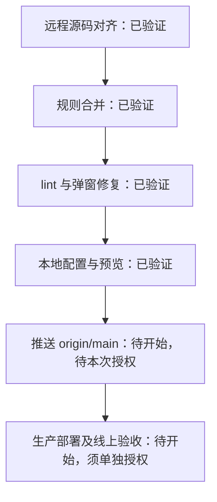

# SeineShop 项目进度

更新时间：2026-11-03（Asia/Shanghai）。这是本次检查后的状态快照；本文件仅供内部使用，不作为公开页面或构建输入。随阶段切换、遇阻、验收和发布更新，保留完成依据。

| 节点 | 完成依据与范围 |
| --- | --- |
| 远程源码对齐、规则合并 | [对齐验收](qa/2026-11-02-remote-alignment.md)；沿用原目录与远程框架版本，无额外工作树或旧工程备份 |
| lint 与弹窗修复 | [本地修复验收](qa/2026-11-02-local-check-fixes.md)；2026-11-02 测试、构建及代表交互记录，保留已知警告与验证限制 |
| 本地配置与预览 | `SESSION_SECRET` 已完成签名验证；2026-11-03 经单项授权补齐结账域名，商品页缺少域名报错消失，首页/购物车 200；仅本机监听 |
| 推送、部署 | 本轮尚未执行；线上原有店铺已部署，本轮改动未发布 |

下一步：需要上传时，先列出本次提交、文件与验证结果，请用户明确批准推送 `origin/main`；生产部署另获授权。现有缺口：完整分析/同意管理、既有开发模式提示、跨浏览器遮罩交互及线上验收，详见修复验收。按用户要求保留店铺密码，暂不验证完整结账。
