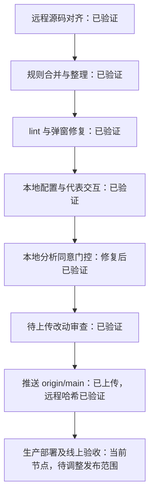

# SeineShop 项目进度

更新时间：2026-11-04 15:28（北京时间，UTC+08:00）。这是本次检查后的状态快照；本文件仅供内部使用，不作为公开页面或构建输入。随阶段切换、遇阻、验收和发布更新，保留完成依据。

## 当前发布节点（2026-11-04 15:28）

- T13 进行中：用户已授权本次“除 GA4 外”的既有改动推送 origin/main 并部署 Production。新候选保留原 GA4，弹窗与 lint 修复保留。
- 本轮 lint、35 测试、codegen、build、集合筛选及构建来源审计通过；GA4 collect 返回 204，桌面/手机弹窗、白色变体加购、数量修改与刷新保留通过。Toolkit 隔离类型解析和既有构建提示仍有局限。
- 待完成：本批提交与推送核对；后台安全验证由用户本人完成，随后记录生产当前版本/回滚目标、部署及真实域名复验。尚未执行本批推送或部署，T14 未开始。
- 13/15 项已验证，当前在阶段六 T13。T10 的同意管理结果属于已停用的历史候选，不是现行 GA4 行为。
- 依据：[本轮发布记录](plans/2026-11-03-oxygen-production-release.md)。以下为截至 2026-11-03 的历史快照，发布状态以本节为准。

展示约定（2026-11-03 用户指定）：以 [GEOly 交互路线图](https://claude.ai/artifact/SmRXGvGVFSzJK4hfAHa9Sq#overview) 的形式为参考，采用阶段线路、任务方块、状态颜色及文字、“当前在这里”标记、阶段切换与任务详情展开，并展示当前任务和近期动态。详情保留完成依据、验收及下一步；工期和 KPI 仅采用已确认的本项目数据。已查看参考公开页面与展开的任务详情，仅借鉴展示形式，不将参考项目的任务、日期、状态或发布流程当作本项目事实。

当前展示实现：[交互网页](project-progress.html)已完成本地验证，包含六阶段线路、15 项任务、当前位置、详情展开、搜索与状态筛选、近期动态和验收来源。使用 `node scripts/serve-project-progress.mjs` 后打开 `http://127.0.0.1:4174/`；亦可直接用浏览器打开 HTML 文件。下方 Mermaid 保留为简明记录。网页数据手动同步，不自动读取 Git、Shopify 或改变任务状态；仅供内部使用，不发布到客户网站。验证范围见 [网页验收](qa/2026-11-03-project-progress-web.md)。

本次维护任务 T15：规则整理已完成内部文档验证，归入阶段二；当前位置回到阶段六的 T13。主发布任务的候选调整和验收独立记录，本轮不为并行前台修改背书。

维护要求：每完成一项任务，立即同步此记录与交互网页的任务状态、当前位置、完成数量、动态、依据及下一步；验收失败不标完成。当前进入阶段六：用户批准的 9 个提交、48 个文件已上传 origin/main，T12 远程哈希核对通过；15 项任务中 13 项已验证（12 项本地检查，含本次规则文档验收；1 项远程上传核对）。T13 因用户要求保留线上 GA4，原发布候选停止，待排除 GA4 改动后重新准备范围。见 [上传审查及结果](qa/2026-11-03-upload-review.md)、[同意管理修复复验](qa/2026-11-03-analytics-consent.md)。GA4 后台归因、购买转化及生产验证仍未完成。

| 节点                   | 完成依据与范围                                                                                                                                                                                                                                      |
| ---------------------- | --------------------------------------------------------------------------------------------------------------------------------------------------------------------------------------------------------------------------------------------------- |
| 远程源码对齐、规则合并 | [对齐验收](qa/2026-11-02-remote-alignment.md)；沿用原目录与远程框架版本，无额外工作树或旧工程备份                                                                                                                                                   |
| lint 与弹窗修复        | [本地修复验收](qa/2026-11-02-local-check-fixes.md)；2026-11-02 测试、构建及代表交互记录，保留已知警告与验证限制                                                                                                                                     |
| 本地配置与预览         | `SESSION_SECRET` 已完成签名验证；2026-11-03 经单项授权补齐结账域名，商品页缺少域名报错消失，首页/购物车 200；仅本机监听                                                                                                                             |
| 本地分析同意管理       | T10 已复验；拒绝刷新后 GA 脚本和请求均 0，接受后单次初始化并发送请求（204），撤回与客户端跳转不增加请求；EN/JA/DE 及手机、键盘代表交互通过。35 项测试、lint 0 错误/2 既有警告、构建及来源审计通过；Toolkit 独立类型校验受限，完整商业分析及生产另验 |
| 规则整理 T15 | 根 AGENTS.md 从 10,082 缩减到 6,762 字节；授权红线保留、按任务读取入口和验证表已检查，当前/历史分离，来源限制保存在仓库内；本次文档与进度页检查通过，不含并行前台验收 |
| 内部交互路线图         | 2026-11-03 桌面及手机布局、阶段/任务交互、筛选、键盘操作与来源链接已验证；仅本地展示                                                                                                                                                                |
| 推送、部署             | 获准批次已推送，远程 main 为 `56ffe2ef09ba2274837694871a052389fd332374`；未执行本轮生产部署，线上原店铺保持既有运行状态。本次上传后的进度记录只在本地更新，后续推送需另获批准                                                                       |

近期动态：2026-11-03 15:46（北京时间，记录时间）T15 规则整理完成内部文档验证，根文件缩减约三分之一；规则、链接、命令及进度页检查通过，13/15 项已验证。当前位置回到 T13；保留线上 GA4 的限制继续有效。本轮未提交、推送或部署。

下一步：继续按独立发布准备记录调整并验证保留线上 GA4 的候选；不能直接发布原整包候选。需明确实际提交、文件范围和目标，再分别取得本次 push 与生产部署批准；保留店铺密码，不进行完整结账。本轮规则文档先在本地交付，并行出现的前台、README、发布准备和生成类型修改不纳入本次验收。

时间展示更新（2026-11-03 15:20 北京时间）：顶部最近更新与近期动态补充小时、分钟；历史动态依据对应 Git 提交时间补齐并明确标为记录时间，页面刷新不改写时间。已核对提交时间顺序；展示改动不改变 12/14 的任务状态，也不构成部署授权。本轮沿用现有字体和布局。

范围调整（2026-11-03 15:29 北京时间，记录时间）：用户要求先保留线上 GA4。本轮未执行部署；CLI 已只读核对 Production 的 production/main/www.seineshop.com。线上仍有旧脚本，精确生产提交与回滚部署未核对。[原候选停止记录](plans/2026-11-03-oxygen-production-release.md)已修订；T13 为受阻、待调整范围，12/14 验证数量保持不变。时间展示已在桌面和 390px 手机检查，无横向溢出；日期时间合法并按记录时间倒序。

规则整理（2026-11-03 15:43 北京时间，记录时间）：用户批准审查建议后，重新 fetch 确认远程无新增提交，保留本地领先的两条文档提交。T15 已加入阶段二；根规则精简、授权去重、当前/历史分离、验证表和仓库内来源限制已修改，待执行文档与网页检查。只修改内部文档，不改前台、依赖、环境、CI/CD 或发布候选。

规则整理验收（2026-11-03 15:46 北京时间，记录时间）：按 OpenAI 官方 [AGENTS.md 指南](https://learn.chatgpt.com/docs/agent-configuration/agents-md)与[最佳实践](https://learn.chatgpt.com/guides/best-practices#make-guidance-reusable-with-agentsmd)整理。T15 已验证：7 个文档 UTF-8 严格解码、相对路径/锚点、授权及商业约束保留、package.json 命令入口核对通过；进度 HTML 内联脚本语法、任务唯一性与阶段引用通过。现有本机服务返回 200 和 text/html; charset=utf-8，浏览器新增任务的中文、详情和来源入口可读。未运行前台 lint/测试/构建，本轮范围为文档与进度数据；不沿用并行任务的验证结果。此前 15:43 的“进行中”保留为历史，本次标记 13/15 项已验证。
