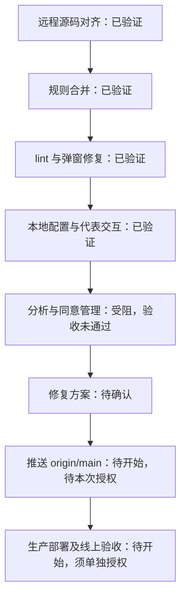

# SeineShop 项目进度

更新时间：2026-11-03（Asia/Shanghai）。这是本次检查后的状态快照；本文件仅供内部使用，不作为公开页面或构建输入。随阶段切换、遇阻、验收和发布更新，保留完成依据。

展示约定（2026-11-03 用户指定）：以 [GEOly 交互路线图](https://claude.ai/artifact/SmRXGvGVFSzJK4hfAHa9Sq#overview) 的形式为参考，采用阶段线路、任务方块、状态颜色及文字、“当前在这里”标记、阶段切换与任务详情展开，并展示当前任务和近期动态。详情保留完成依据、验收及下一步；工期和 KPI 仅采用已确认的本项目数据。已查看参考公开页面与展开的任务详情，仅借鉴展示形式，不将参考项目的任务、日期、状态或发布流程当作本项目事实。

当前展示实现：[交互网页](project-progress.html)已完成本地验证，包含六阶段线路、14 项任务、当前位置、详情展开、搜索与状态筛选、近期动态和验收来源。使用 `node scripts/serve-project-progress.mjs` 后打开 `http://127.0.0.1:4174/`；亦可直接用浏览器打开 HTML 文件。下方 Mermaid 保留为简明记录。网页数据手动同步，不自动读取 Git、Shopify 或改变任务状态；仅供内部使用，不发布到客户网站。验证范围见 [网页验收](qa/2026-11-03-project-progress-web.md)。

维护要求：每完成一项任务，立即同步此记录与交互网页的任务状态、当前位置、完成数量、动态、依据及下一步；验收失败不标完成。当前回到阶段四：T10 本地检查发现 GA4 未遵循拒绝分析的选择，验收未通过。见 [失败证据](qa/2026-11-03-analytics-consent.md)与[待确认修复方案](plans/2026-11-03-analytics-consent-fix.md)。

| 节点 | 完成依据与范围 |
| --- | --- |
| 远程源码对齐、规则合并 | [对齐验收](qa/2026-11-02-remote-alignment.md)；沿用原目录与远程框架版本，无额外工作树或旧工程备份 |
| lint 与弹窗修复 | [本地修复验收](qa/2026-11-02-local-check-fixes.md)；2026-11-02 测试、构建及代表交互记录，保留已知警告与验证限制 |
| 本地配置与预览 | `SESSION_SECRET` 已完成签名验证；2026-11-03 经单项授权补齐结账域名，商品页缺少域名报错消失，首页/购物车 200；仅本机监听 |
| 完整分析与同意管理 | T10 未完成；2026-11-03 独立会话拒绝分析并刷新后，Shopify 返回不允许分析，GA4 仍发送 page_view（204）；待批准修复方案，不能标已验证 |
| 内部交互路线图 | 2026-11-03 桌面及手机布局、阶段/任务交互、筛选、键盘操作与来源链接已验证；仅本地展示 |
| 推送、部署 | 本轮尚未执行；线上原有店铺已部署，本轮改动未发布 |

下一步：用户确认分析同意修复方案后实施并复验，完成后即同步流程图。之后准备本次上传审查，推送 `origin/main` 与生产部署分别取得授权。其他缺口：既有开发模式提示、跨浏览器遮罩交互及线上验收，详见修复验收。按用户要求保留店铺密码，暂不验证完整结账。
