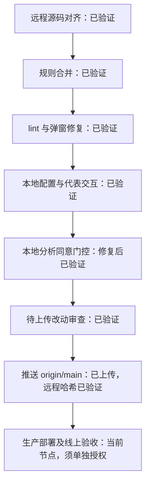

# SeineShop 项目进度

更新时间：2026-11-03（Asia/Shanghai）。这是本次检查后的状态快照；本文件仅供内部使用，不作为公开页面或构建输入。随阶段切换、遇阻、验收和发布更新，保留完成依据。

展示约定（2026-11-03 用户指定）：以 [GEOly 交互路线图](https://claude.ai/artifact/SmRXGvGVFSzJK4hfAHa9Sq#overview) 的形式为参考，采用阶段线路、任务方块、状态颜色及文字、“当前在这里”标记、阶段切换与任务详情展开，并展示当前任务和近期动态。详情保留完成依据、验收及下一步；工期和 KPI 仅采用已确认的本项目数据。已查看参考公开页面与展开的任务详情，仅借鉴展示形式，不将参考项目的任务、日期、状态或发布流程当作本项目事实。

当前展示实现：[交互网页](project-progress.html)已完成本地验证，包含六阶段线路、14 项任务、当前位置、详情展开、搜索与状态筛选、近期动态和验收来源。使用 `node scripts/serve-project-progress.mjs` 后打开 `http://127.0.0.1:4174/`；亦可直接用浏览器打开 HTML 文件。下方 Mermaid 保留为简明记录。网页数据手动同步，不自动读取 Git、Shopify 或改变任务状态；仅供内部使用，不发布到客户网站。验证范围见 [网页验收](qa/2026-11-03-project-progress-web.md)。

维护要求：每完成一项任务，立即同步此记录与交互网页的任务状态、当前位置、完成数量、动态、依据及下一步；验收失败不标完成。当前进入阶段六：用户批准的 9 个提交、48 个文件已上传 origin/main，T12 远程哈希核对通过；14 项任务中 12 项已验证（11 项本地检查、1 项远程上传核对）。T13 等待单独的生产部署授权。见 [上传审查及结果](qa/2026-11-03-upload-review.md)、[同意管理修复复验](qa/2026-11-03-analytics-consent.md)。GA4 后台归因、购买转化及生产验证仍未完成。

| 节点                   | 完成依据与范围                                                                                                                                                                                                                                      |
| ---------------------- | --------------------------------------------------------------------------------------------------------------------------------------------------------------------------------------------------------------------------------------------------- |
| 远程源码对齐、规则合并 | [对齐验收](qa/2026-11-02-remote-alignment.md)；沿用原目录与远程框架版本，无额外工作树或旧工程备份                                                                                                                                                   |
| lint 与弹窗修复        | [本地修复验收](qa/2026-11-02-local-check-fixes.md)；2026-11-02 测试、构建及代表交互记录，保留已知警告与验证限制                                                                                                                                     |
| 本地配置与预览         | `SESSION_SECRET` 已完成签名验证；2026-11-03 经单项授权补齐结账域名，商品页缺少域名报错消失，首页/购物车 200；仅本机监听                                                                                                                             |
| 本地分析同意管理       | T10 已复验；拒绝刷新后 GA 脚本和请求均 0，接受后单次初始化并发送请求（204），撤回与客户端跳转不增加请求；EN/JA/DE 及手机、键盘代表交互通过。35 项测试、lint 0 错误/2 既有警告、构建及来源审计通过；Toolkit 独立类型校验受限，完整商业分析及生产另验 |
| 内部交互路线图         | 2026-11-03 桌面及手机布局、阶段/任务交互、筛选、键盘操作与来源链接已验证；仅本地展示                                                                                                                                                                |
| 推送、部署             | 获准批次已推送，远程 main 为 `56ffe2ef09ba2274837694871a052389fd332374`；未执行本轮生产部署，线上原店铺保持既有运行状态。本次上传后的进度记录只在本地更新，后续推送需另获批准                                                                       |

近期动态：2026-11-03 用户明确批准本批后，复核工作区及提交头未变，普通推送到 origin/main 成功；ls-remote 与 fetch 读回远程 main 均为 `56ffe2e`。T12 已验证，转入 T13 等待生产部署授权。此前 35 项测试、lint、集合筛选和来源审计通过；本轮仅 Git 上传与状态记录，无前台代码改动。

下一步：准备本批 Oxygen 生产发布范围与目标核对，取得单独授权后才部署；外部自动发布关联尚未实时复核，不能据仓库无工作流声称全平台未配置自动部署，也不能把 Git 上传当作已部署。其他缺口：GA4 后台归因/购买转化、跨地区与跨浏览器、既有开发模式提示、线上编码和 SEO 验收。保留店铺密码，暂不验证完整结账。此次上传结果和流程图更新保存为本地后续记录，不追加至已批准的推送批次。
