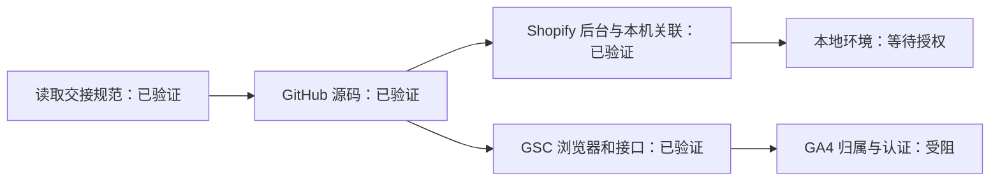

# 项目连接状态与授权记录

## 当前：GA4 六事件本地候选与未连接结账草稿（2026-11-17）

- 用户在本会话确认实施六事件方案。沿用 `G-BKLZMJ9EP7` 和原共享head初始化，新增商品浏览、实际成功加购及匿名结账会话传递；Shopify结账像素独占开始结账、支付信息提交和购买完成事件，`session_start`仍由GA4自动生成。不扩大历史同意门控修复的发布范围。
- 普通/Bulk Buy/样品真实加购、手机5件/USD95结账、单独1件/USD19 Buy now、返回购物车不变、匿名属性写入/拒绝后清空已验。外部结账返回恢复时重置悬挂fetcher，后退后按钮可用；本机隔离接收器验证结账三事件各1次且重复不多计，0外部请求。没有真实支付或订单。
- 用户本人完成后台验证后，创建并保存 **Seine Shop GA4 Checkout** 自定义像素174522627，Required仅Analytics，读回源码一致、界面仍为Connect；未连接、未改17TRACK/全局隐私或数据出售设置。正式主站未部署，不能称线上六事件已启用。
- 全量118/118测试、lint（0错误/2既有警告）、codegen/build、集合筛选、构建来源审计及差异检查通过；候选/构建118文件扫描6项实际敏感值0匹配。范围见[原分析QA中的本轮验收](qa/2026-11-03-analytics-consent.md#ga4-六事件本地候选验收2026-11-17)。Toolkit购物车查询通过并保留旧字段弃用提示；独立JSX返回null类型检查有工具限制，不称全项目类型验收。真实测试店支付、正确GA4资源入库及跨域归因仍待启用后的验证。
- 本地main起点与远程同为483164b；原两张未跟踪截图保留，仅复用主目录。没有新依赖、凭据/.env、CI/CD或schema变更，没有push/生产部署。下一步在最终检查后申请本次 `origin/main` 推送；主站发布和像素连接分别确认。

## 本地仓库第一批精简（2026-11-17）

- 用户确认开始第一批清理：删除未使用的 `app/components/ProductImage.jsx`、`app/components/MockShopNotice.jsx` 及后者专属 CSS；移除 `graphql-tag`、`react-router-dom`、`eslint-plugin-jest` 三项直接依赖声明。GraphQL 工具仍间接使用 `graphql-tag`，保留对应锁定包；所有保留包版本与平台元数据不变。README 和 RELEASE-NOTES 同步说明。
- 开工 fetch 后 main 与 origin/main 同为 `be226a9`，只有一个分支和工作副本；既有两张未跟踪截图保留。没有处理缓存、其他截图、停用分析同意实现、商品预览或旧进度脚本；没有修改凭据、CI/CD、商品或生产配置。
- 本轮验证：99/99 测试、lint（0错误/2既有脚本警告）、codegen、build、集合筛选、构建来源暴露审计通过；`npm ci --dry-run --ignore-scripts --offline --no-audit --no-fund --cache .cache/npm` 退出0，锁文件与声明一致。Hydrogen 内部提示跳过 typegen 后，codegen 命令中的独立 `react-router typegen` 退出0；仍保留 envFile 弃用、React Router 未来选项和构建分析器提示，不视为全项目类型验收。
- 无公开 URL、页面内容或 sitemap 生成源变化，已有 sitemap 测试包含在99项中；删除组件及样式无应用引用，因此本轮没有启动浏览器或复验线上。仅本地清理，尚未推送或生产部署。

## 文档清理（2026-11-17）

用户明确要求删除此前列出的三份旧资料：`docs/plans/2026-11-03-oxygen-production-release.md`、`docs/project-progress.md`、`docs/project-progress.html`。仅清理文档及关联入口，不改网站源码、生产部署或 Git 历史；两张11月4日本机截图保留。历史连接与发布摘要继续保存在本文件，原验收记录保留并标注停用，旧进度服务不再启动。

本轮验证：三文件不存在、两截图仍在；5份修改文件严格UTF-8解码及52个相对文件链接通过，旧服务脚本语法检查和实际运行退出0且仅提示停用；全量lint为0错误、2条既有脚本警告，diff空白检查通过。未推送、未部署。

## 当前：正式环境配置补齐，验收截图按用户要求取消跟踪（2026-11-16，22:46 北京时间）

- 用户明确批准本次12个候选提交推送及主站Oxygen生产部署；`origin/main`已读回完整哈希`1aa4e07ad772dda9a93bdab95d1fb31902ab66d5`。发布前再次通过99/99测试、lint（0错误/2既有警告）、codegen/build、集合筛选及构建来源审计；213个候选/构建文件的本机实际敏感值扫描0匹配。原无关发布方案、旧进度资料和截图保留。
- 用户另行明确批准将现有`CUSTOMERSSAY_SECRET_KEY`、`SECTIONLY_B2B_PRIVATE_KEY`配置到Oxygen Production；两项均设为Secret，最终读回仅Production。未上传整份.env、代发测试凭据或本机服务地址，没有修改其他密钥。生产评价读取与设置、B2B询价表单读取均200，公开评价仍0，内部测试未公开。
- 官方CLI首次部署为后台资源`5746750`/Deployment ID `6129563`，18:37 GMT+8、业务源码`1aa4e07`。用户确认补齐配置后再次部署成功并完成可路由验证；当前后台资源`5749637`/Deployment ID `6132418`，22:44 GMT+8、Production/main/`813e4b6`、Ready/Current，部署地址`https://01m7jd1bn3nq8ea83btyj00ttb-d7e83d6aec4307f1a21e.myshopify.dev`。813e4b6仅增加验收资料，应用源码仍等同1aa4e07，正式域名`https://www.seineshop.com`。使用`--force`仅允许保留不参与构建的文档工作区，未跳过部署验证、未覆盖远程环境。
- 正式站实测Bulk Buy黑2/白3、5件/USD95与Shopify购物车一致；独立运费报价Standard USD12/Fast USD18，之后购物车仍5件。询价联系字段必填，评价弹窗/图片控件可用；英/日/德商品canonical及手机布局检查通过。114个sitemap分片/23967 URL快照均200/UTF-8，未包含私有工作台/API；文本响应charset、浏览器中文/日文/德文及特殊符号正常。详见[原QA的生产验收](qa/2026-11-13-business-layout.md#oxygen-production-发布验收2026-11-16)。
- `/dropshipping`页面已随主站发布，明确显示Development preview；未登录不可导入，private/no-store/noindex，未部署本机独立代发服务，正式环境没有测试店凭据。外部客户OAuth、订单采购/仓库履约/运单回传、自动阶梯价、站内私有附件仍未完成。17TRACK原入口与空输入校验复查正常，未用虚构运单作运输验收。
- 用户明确确认仅Production补充`PUBLIC_CHECKOUT_DOMAIN=ps83if-c4.myshopify.com`并重新部署。正式商品页强刷后控制台无error/warn，Shopify customerPrivacy API已加载，评价/询价/运费读取均200；robots/llms/sitemap/static XML再次200且charset=utf-8。本轮99/99测试及构建来源审计通过，应用代码没有新增变更。
- 验收资料813e4b6经用户确认推送后，用户要求撤回三张正式截图。现仅取消跟踪`2026-11-16-oxygen-inquiry-desktop.jpg`、`2026-11-16-oxygen-reviews-desktop.jpg`、`2026-11-16-oxygen-customization-de-mobile.jpg`，本机原图保留并加入本机忽略清单；文档去掉相对图片链接，保留文字验证结果，不改写Git历史。工程规范明确截图默认本机留存、历史图不作为当前视觉规范；没有清理其他历史图片或无关工作区成果。

## 历史：真实评价/询价补验完成，自主测试规则已调整（2026-11-16，17:45 北京时间）

- 用户明确允许两项真实内部测试，并要求以后常规测试不逐项等待批准。已先同步根规则、工程/Git/业务工具规范、原接入方案及README：最小内部QA可直接执行，已有批准范围不重复申请；保留每次push、生产发布、删除、凭据/.env/权限/数据定义及其他明确红线。
- 新构建网页真实上传一张Internal QA图片并提交3星测试评价，各200；后台1条Unpublished，正文和图片读回成功，公开列表仍0/平均0，商品HTML无测试正文或AggregateRating。真实签名图片代理200/image/png/private,no-store/15377字节，SHA256与原图一致。本机原Worker直连CDN超时，命令级使用现有代理后通过；未改.env/系统配置/生产策略。
- 询价实测发现漏传供应商要求的productTitle，现仅发送服务端Shopify实际标题，保留客户端价格/标题不可信校验；回归先复现失败再修复。原qa@seineshop.example测试询价已保存，但Shopify拒绝其域名、未生成草稿；依据新自主测试规则改用保留示例邮箱qa@example.com补测，生成询价cmwj2n21500fmqx3gqmtw5kfv及原生草稿#D1/1381027840259（Black/6630000794A/1件/USD19），备注和电话一致。相同operationId/payload重放仍同一询价ID；后台保留2条内部询价、1张未付款草稿及关联测试公司/联系人，不删除、不主动通知、不付款/收费/发货。
- 修复后99/99测试、lint0错误/2既有警告、codegen/build、筛选及构建来源审计通过。Toolkit2026-04独立源码检查有17条既有JS/DOM通用类型诊断，修复前基线相同；未记为通过、未加忽略。详见[既有QA末尾真实补验](qa/2026-11-13-business-layout.md)。
- 当前本机预览3008仍仅回环，未重开官方临时公开通道。Oxygen后台仍Connect GitHub、无已连接自动部署仓库；生产Current保持865d945。未push/部署；原无关发布方案/进度资料/截图保留。完整外部客户OAuth、订单采购/仓库履约/运单回传、自动阶梯价、站内私有询价附件仍未完成，通知/付款/公开测试评价未执行。

## 历史：未推送功能补验，真实评价/询价提交待测试授权（2026-11-16，16:27 北京时间起）

- 用户要求每个功能完成先验证，通过后下一步询问是否推送，已先写入根规则和Git工作流。远程main仍46182bd，本地9ece6bc领先10提交；未push/部署，无关历史工作区成果保留。
- 本轮全量99/99测试、lint（0错误/2既有警告）、codegen/build、集合筛选和构建来源审计通过。新构建仅回环3008；评价真实读取/非法筛选与附件拒绝、询价空电话服务端拒绝、三模式切换、390px界面及样品实际加购均补验。英/jp/de私有工作台200，API GET405，测试店草稿只读核对仍verified=true/DRAFT/库存0/2规格/2READY图片。详见[原验收文档末尾的补验记录](qa/2026-11-13-business-layout.md)。
- 后台评价当前手动发布、B2B通知邮箱为空。已单独请求一条未发布内部测试评价/测试图、一条测试询价及自动草稿的明确授权；截至本摘要写入尚未回复，未执行写入，不能称真实提交闭环已通过。未重新开启已结束的官方临时通道，先前客户登录/连接/网页导入证据保留。
- 外部客户OAuth、采购/仓库履约/运单回传、自动阶梯价、站内私有询价附件尚未实现。只有已实现的阶段功能通过本轮代码/边界补验，不把整套商业流程记为完成。

## 历史：客户登录与测试店工作台联调通过，临时通道已关闭（2026-11-16，北京时间）

- 用户本轮回复「允许本次临时测试链接」，批准官方临时 HTTPS 开发预览，仅用于客户登录及指定测试店联调。用户完成网站客户登录后，真实返回携带原商品参数的工作台；连接指定测试店、网页导入B20A、查看商品、刷新后连接/任务持久化均通过。目标仍为15524635443473、结果reused，没有重复创建或改写商品。
- 官方临时预览使用本机3007，独立服务3460仍回环。已正常终止本轮预览，3007监听和对应连接进程均不存在。相同临时回调的官方授权检查从清理前200变为清理后400/redirect_uri mismatch，确认临时回调不再获准；没有修改生产回调。无生产发布、外部客户店分发或实际订单授权。

- 沿用已批准的完整方案，新增 `/dropshipping`（英/日/德）：商品 Dropshipping 模式绿色入口、账户菜单、登录返回、连接/商品/订单区域、商品链接导入、任务记录和显式重试。网页不接受浏览器提供的租户/凭据；独立 Node 服务仅监听 127.0.0.1:3460，校验签名、时间、nonce、Host；会话 AES-GCM 加密并绑定租户/店铺。当前是指定测试店链路，未来入口面向真实客户，但独立客户店OAuth与完整订单业务尚未开放。
- 用户本轮明确回复「允许这项测试配置」，仅测试店新增 SHOP 应用私有 JSON 定义 `connection_vault` / `order_ledger`，均已真实 API 读回 type=json、Storefront NONE；CLI 配置校验 valid=true/issues=[]。本机 `.env` 只追加 `DROPSHIP_SERVICE_URL=http://127.0.0.1:3460`，原有字节保留、0600、Git 忽略。使用原密钥，无新增密钥或正式店配置变更。
- Shopify CAS 私有存储限制20连接、50任务、每字段100 KB，冲突重读，超限停止、不删除。此前空状态只读检查保留在QA；本轮实际私有字段读回为1个加密开发连接、1个completed任务，未输出客户ID或凭据。原B20A草稿再次独立只读核对：DRAFT/未发布、2规格、2图片READY、库存0，未修改商品。
- 本轮99/99测试、lint（0错误/2既有脚本警告）、codegen/build、集合筛选与构建来源审计通过。源码/文档/构建256文件针对6项实际敏感值扫描0匹配。既有Admin/Customer GraphQL 2026-04校验证据保留；本轮无查询变更。Hydrogen组件检查仍未发现适用Shopify组件，不能当作完整TypeScript验收。保留nonce hydration、React Router未来选项、envFile弃用及构建分析器提示。已登录桌面及390px日德手机、private/no-store/noindex响应、错误CSRF拒绝均实测；见[本轮HTTPS QA](qa/2026-11-13-business-layout.md#临时-https-客户登录联调2026-11-16)及[已连接工作台截图](qa/2026-11-16-dropship-workspace-connected-desktop.jpg)。
- 修复官方临时代理终止TLS导致本机URL为HTTP、浏览器Origin为HTTPS而同源校验403的问题：只在开发构建、精确官方域名与HTTPS转发协议下恢复请求URL，再创建会话/校验。仅开发构建允许HTTPS官方预览访问本机HTTP服务；最终生产包两个调用均为development=false，未放宽生产。没有保留临时诊断日志、修改.env或新增密钥。
- `order-plan.mjs`已准备订单快照读取与纯代码校验：付款/取消、完整行数据、稳定规格映射、未履约数量、币种、订单变化、单独采购收款及数量核对；未接到运行中的订单处理。没有新增订单/客户/履约权限、创建订单、付款或发通知。外部客户OAuth、真实采购/仓库履约与运单回传、自动阶梯价、私有询价附件仍待实施。
- 本轮开工与提交前fetch均通过现有本机代理成功，origin/main无新增，保留原9个本地提交及无关发布方案/旧进度/旧截图。官方连接组件仅下载到忽略的项目工具缓存，未安装全局依赖或修改系统/持久Git配置。复用主目录，不维护进度图、不删除文件、未push或部署。

## 历史：测试店草稿导入已连通，运费入口更名（2026-11-16，北京时间）

- 用户本轮明确批准「允许测试应用、配置和映射定义」。官方 CLI 创建 **Seine Shop Dropshipping Dev**（App ID 447811256321，组织 233393793），仅在免费开发店 `seine-shop-dropship-test.myshopify.com` 启用开发预览。配置和源码保存在 `apps/dropshipping/seine-shop-dropshipping-dev/`，没有发布应用新正式版本或选择不可逆分发方式。
- 本机 `.env` 仅新增获准的 `DROPSHIP_APP_CLIENT_ID`、`DROPSHIP_APP_CLIENT_SECRET`、`DROPSHIP_TOKEN_ENCRYPTION_KEY`，文件 0600/Git 忽略，不记录值。官方 client credentials grant 只用于同组织开发店，管理 token 仅内存缓存并按需重新获取；不是独立客户店 OAuth。加密密钥为后续授权存储预留，本轮尚未存储客户店 token。
- 已建并读回三类应用私有定义，均 Storefront NONE：Product app.source_id（`id`/unique）、Variant app.source_id（单行文本）、product_mapping 元对象（源店铺/商品、目标商品引用、规格映射、币种和快照哈希）。实测 customId 查询要求 `id` 类型，原空单行定义已修正；源公开商品只读复用现有 PRIVATE_STOREFRONT_API_TOKEN，未改正式店凭据。
- 实际导入一个 **B-20A 3-in-1 Foldable Wireless Charging Station** 草稿：源商品 9764421861635 → 测试商品 **15524635443473**。两个规格、两张图片 READY，逐规格售价/选项/SKU/图片关联及私有映射读回通过；库存保持 0、tracked/DENY、DRAFT、publishedAt=null。再次运行返回 reused/相同目标 ID，没有第二次建品或覆盖商家编辑。可用 `run-import.mjs <handle> --verify` 重做只读核对，证据位于忽略的 `.cache/dropship-import-readback-2026-11-16.json`。
- 运费入口改为 **Estimate shipping**，日语「送料を見積もる」、德语「Versandkosten berechnen」，保持在批发购买按钮下。新构建桌面/英日德手机、真实USD12/18报价、Escape焦点与购物车不变已验；[红圈截图](qa/2026-11-16-shipping-estimate-entry-annotated.png)和[完整 QA](qa/2026-11-13-business-layout.md#运费命名更新与开发店草稿导入2026-11-16)已补齐。82/82测试、lint 0错误/2既有警告、codegen/build、集合筛选与构建来源审计均通过，真实密钥扫描0匹配；独立App配置与GraphQL 2026-04校验通过。没有新增公开 URL；保留现有 sitemap 源和商品条目，不伪造 lastmod。
- 当前完成的是本地服务端商品导入链路，网站代发工作台、独立客户店授权、订单采购/履约运单回传、自动阶梯价和私有询价附件仍待开发。没有测试订单、真实交易、正式店商品/库存写入、push 或生产部署。本轮只复用主目录，保留原有无关修改；官方初始化生成的空 Git 元数据已移动保存到 `.cache/tooling/dropshipping-scaffold-git-2026-11-16`，未删除。

## 历史：免费代发测试店、后台恢复与运费查询（2026-11-16，北京时间）

- 用户明确要求创建免费的代发开发测试店；已通过专用浏览器的 Dev Dashboard 创建 **Seine Shop Dropship Test**，域名 `seine-shop-dropship-test.myshopify.com`，后台入口 https://admin.shopify.com/store/seine-shop-dropship-test 。刷新开发店列表读回 **Dev / Basic**，组织 My Store（233393793）、店铺 ID 99029909777；后台域名页再次读回该主域名 Connected。未选择付费试用、购买套餐/域名、生成示例数据或开启 feature preview；没有安装应用、创建凭据或测试订单。Basic 是开发店模拟功能环境，不是新购付费套餐。
- 测试店用于模拟代发客户店，与供货店 `ps83if-c4.myshopify.com` 分开。官方开发店限制为测试用途、密码保护、不能处理真实交易或转交客户；后续授权应用、商品映射、采购与履约回传尚未完成。见[现有方案的测试店记录](plans/2026-11-13-reviews-b2b-integration.md#免费代发测试店2026-11-16)。
- 按用户要求补充[运费入口圈选图](qa/2026-11-16-shipping-entry-annotated.png)：基于已有本地预览原图，圈出 Buy now 下方右侧 More Shipping Options，保留原图；仅增加标注，没有改变界面或发布生产。

- 用户已完成安全验证，专用 Chrome for Testing 实际打开 Seine Shop / ps83if-c4 后台。Sectionly 设置子页首次导航曾报应用错误，重新加载后恢复；不是登录阻碍，也不能据此断言功能不存在。系统姓名/公司/邮箱必填，自定义字段只见文字/下拉/数字，无附件类型；通知邮箱为空、MOQ=1。应用介绍提供询价→报价→付款链接→支付转订单，当前没有真实询价，交易闭环尚未实测。
- 用户明确批准创建 **365 天、仅服务端** B2B 私钥，权限 config:read / products:read / inquiries:write，并仅替换本机 `.env` 的 SECTIONLY_B2B_PRIVATE_KEY。后台读回 Active、到期 **2027-11-16（UTC）**；本机文件 0600、Git 忽略，逐行确认其余环境项不变，剪贴板已清空。真实 `/form-config` 与 `/b2b-products` 均 200，本机 Worker 询价 setup 同样 200/defaultMoq=1；没有真实询价、草稿订单或通知，也没改生产密钥。原 1 天密钥已过期，未撤销其他密钥。
- 本地新增 **More Shipping Options**，位置在批发购买按钮下；目的地下拉、州省/城市/邮编/街道与 Shopify 固定配送报价接通。使用独立估算 Cart，不修改原购物车或地址簿、不创建订单。真实验收：B-20A 黑色 1 件寄美国公开示例地址，Standard USD12 / Fast USD18；6 件均返回 USD0，符合现有后台免运费条件；原购物车仍为 5 件。只估算本商品，最终费用/税费在结账复核；没有接承运商实时报价或复制时效承诺。
- Shopify 原生 Companies 和 Catalogs 在本店 Basic 后台实际可用、当前均为空；新目录能打开，但产品/计价编辑要求先保存。已取消保存，没有新建公司、目录或折扣。折扣列表为空，创建类型只见四种 Shopify 原生折扣；不能把“无额外应用类型”或目录入口当作自动阶梯计价已验证。需继续核实原生 B2B 买家身份/市场/阶梯能力；既有管理 App 历史为单店 custom distribution，不能直接给独立客户店使用。
- 运费实现此前 74/74 测试通过；lint 0 错误、2 既有警告，codegen/build 和集合筛选/构建来源审计通过。桌面/手机、失败保留、键盘与语言验收详见[现有布局 QA](qa/2026-11-13-business-layout.md#商品页运费查询与后台恢复2026-11-16)。新资源 private/no-store/noindex，保留原商品 URL，未加入 sitemap。阶段成果保存为本机提交，未 push/部署；完整自动阶梯价、私有询价附件、代发连接/同步/履约仍未完成；用于模拟客户的测试店现已创建。本次仅补充文档和圈图，不以此前工程检查代替新功能验收。
- 本次复用主目录，提交前再次 fetch 成功且 origin/main 无新增，本地既有 6 个提交及已有未提交成果保留。无关发布方案、旧进度文件与截图没有纳入本次修改范围；没有新工作副本，不删除文件。

## 历史：三种采购模式完整方案批准与批量购买（2026-11-16，北京时间）

- 用户补充：代发由本站自己的仓库发货；数据优先存 Shopify 原生资源、元字段、元对象与文件。原先外置 SQL 数据库建议已降为历史草案，接入方案改为 Shopify 优先；仍需核实私有附件、应用授权、并发任务恢复与运行能力，不把数据存储当作自动同步已经实现。已把专用浏览器的 Seine Shop 安全验证页置前，页面提示身份验证器验证码，等待用户自行完成。
- 已有 CLI 认证仍可执行 Admin 只读查询，读回本店 Basic/非 Plus 及完整 PRODUCT 元字段定义；公开参数与评价字段可复用，来源字段继续 NONE。没有新增认证、权限、定义或业务数据。Functions 的单店自定义应用在 Basic 不适用，已记录官方依据；自动阶梯价仍待核实现有应用/原生能力。
- 本轮已本地实现 Bulk Buy：公开 SKU 分页、独立数量/合计和一次多行购物车操作；独立验收会话真实加入黑 2/白 3 件，Shopify 两行和 USD 95 合计一致，未创建订单/付款。69/69 测试、lint（0 错误/2 既有警告）、codegen/build、集合筛选和构建来源审计通过；桌面/手机、失败恢复、键盘及日德译文验证见[本轮 QA](qa/2026-11-13-business-layout.md#多规格批量购买与-shopify-优先方案2026-11-16)。完整代发、自动折扣、私有附件和运费仍未完成；代码未提交、未 push/部署。
- 用户于 2026-11-16 明确回复“推进”，批准完整方案；具体配置、数据库、真实业务写入、push 与发布仍分别授权。本轮使用系统已有代理进行单次 fetch 成功（未修改持久配置），远程 main 无新增提交，本地领先 5 提交及未提交成果保留。开始实现真实多规格批量购买。Shopify 后台待用户安全验证，实际发货方式和云账号信息已异步询问。

- 用户最新要求三模式及每个按钮后的页面/业务结果完整对齐。完整清单并入[原接入方案](plans/2026-11-13-reviews-b2b-integration.md#三模式完整流程方案)，跨系统方案已批准；不能把代发咨询、邮件附件或前端假价格当作完整实现。
- 已本地加入三模式、定制流程/询价与1件普通样品加购入口；代发货目前只是明确标注未同步的咨询草稿。独立店铺连接、导入/上架、映射、订单同步、履约物流，以及自动阶梯计价、配送报价和站内附件仍待开发/验收。批量采购已由本轮 Bulk Buy 补齐，尚未上线。
- 新鲜63项测试、lint（0错误/2既有警告）、codegen/build、集合筛选和来源暴露审计通过。构建预览在专用浏览器验证；证据追加到[既有布局QA](qa/2026-11-13-business-layout.md#后续三模式阶段草稿与完整目标2026-11-13)。业务提交均本地截住，未写真实询价/订单。
- 开工fetch曾超时，重试成功后核对origin/main无新提交；原5个本地提交及无关未提交资料保留。本轮代码与文档仍是未提交草稿，未push/部署，未改.env/密钥/数据库/CI/依赖。
- 2026-11-14重启本地预览时，CLI读取远程环境提示Shopify认证失败，但已从原有本机.env启动；未更新认证或凭据。此处不代表生产/真实代发业务已接通。

## 询价必填联系方式与参考评价区复核（2026-11-13，北京时间）

- 用户要求联系方式必须填写；本地将电话/WhatsApp 改为必填，保留邮箱必填，并增加服务端拒绝空白/无效号码及规范转存的校验。原布局验收与截图为上一版；本轮验收见其末尾补充。
- 再次实看参考站 B20A：导航含 Reviews，区域在 More Images 后，实际加载 Trustpilot iframe；本次展开正文仍空白，不据此断言商品没有评价。
- 本轮全量 63 项测试通过，lint 0 错误（2 既有警告）、codegen/build 和来源暴露审计通过。浏览器确认空电话阻止提交、无效号码提示及合法号码幂等重试；所有业务 POST 均本地拦截。
- 本轮未修改应用配置/.env，未提交真实业务数据、推送或部署。

## 商品询价与评价入口布局（2026-11-13，北京时间）

- 按用户后续要求，实际查看参考商品页及批发/定制弹窗，主询价按钮移至价格右侧、数量阶梯紧跟价格，弹窗按服务类型/需求/联系信息排列，桌面双列、手机单列；评价区保留详情图后位置，精简标题与写评价入口，采用单选星级。见[布局验收与新版截图](qa/2026-11-13-business-layout.md)。
- Sectionly B2B 官方公开 Headless 文档及 form.js 未提供附件上传能力；这不等于已核实其内部没有其他接口。当前邮箱与电话/WhatsApp 均必填，电话经前后端校验后保存为询价自定义字段；样品链接/目的地备注可选，附件使用邮件补充，没有新增存储或上传功能，没有改后台/.env/密钥。
- 本地全量 62 项测试通过，最终相关回归 27 项通过；lint 0 错误（2 既有警告）、codegen/build、集合筛选及来源暴露审计通过。构建预览与截图在专用浏览器完成，提交交互仅在本地拦截，未产生真实业务记录或通知。
- 本次恢复后 fetch 及提交前再次 fetch 均成功，远程无新增提交；既有无关文档/截图改动保留。未 push、未部署。本次没有新增工作副本。

## 评价与询价本地接入（2026-11-13，北京时间）

- 用户已批准商品标题下紧凑评分、详情图后评价区，以及现有首屏/Wholesale/OEM/ODM 共用在线询价弹窗；本次已实现在本地主目录，未新建副本。
- 用户完成专用 Chrome for Testing 登录，并明确授权创建两把本机开发私钥：B2B 有效期 1 天，权限 config:read / products:read / inquiries:write；Customerssay secret key 用于评价读写。仅新增本机 Git 忽略的两个变量，未改生产、旧密钥或其他连接参数；密钥值不记录于文档或提交。
- 两应用真实只读 API 已返回 200：Customerssay 当前代表商品 0 条评价，表单仅强制评价内容（评分/邮箱仍由接口要求）；允许图片。B2B 默认 MOQ=1、额外字段为空，代表商品未列为专门报价商品。网站按用户批准保留原有通用询价入口与零售价格/购买，不启用隐藏价格或结账限制。
- 真实请求已通过本地 Worker 资源接口读取；运行环境不支持 fetch 的 redirect:error，改为 manual 并拒绝 3xx，避免跟随跳转发送私钥。专用浏览器内扩展会干扰开发页 hydration；同一浏览器中的隔离本地验收页面无该扩展节点且无控制台错误，未修改用户扩展或系统设置。
- 本轮本地检查为 62 项测试通过，lint 0 错误（2 既有警告），codegen/build、集合筛选和构建来源审计通过；文档及前台构建扫描未发现两把新私钥。另有一次浏览器配置排查范围过宽，将相邻 GEO SEO 服务的既有凭据带入工具输出；未写入仓库，尚未轮换，后续轮换需要单独授权，不重复记录凭据值。
- 页面/接口验证、截图与未完成项见 [本轮验收](qa/2026-11-13-reviews-b2b-integration.md)。没有提交真实评价、图片、询价，未创建草稿订单或发送通知；真实业务写入、生产配置与发布仍需具体授权。未 push。

## 历史：本地 main 同步与业务工具开发准备（2026-11-13，北京时间）

- 用户要求拉取远程修改，并将本地必要规则合并到 main；本轮从 `a07e30e` 快进至已获取的 `origin/main` `46182bd`，纳入 12 个提交、51 个文件的远程改动。本轮首次 fetch 25 秒超时；有界重试后 fetch 成功，重新核对远程仍为 `46182bd`，同步后的双向提交日志为空。
- 原有已跟踪文档改动已保存到 Git stash（说明 `seineshop-preserve-local-docs-before-main-sync-2026-11-13`），恢复时保留两边记录并处理状态/旧进度文件冲突；备份未删除。既有未跟踪截图与验收文件保留。旧进度文件仅做冲突恢复，没有增加本轮任务或维护流程图，不纳入本轮规则提交。
- 根任务入口加载第三方业务工具规则，保留远程 sitemap 同步与来源保护要求；品牌按本会话提供的最新规则统一为 Seine Shop。下文的应用安装、商品和生产结果均为带日期的历史核验，本次未重新访问 Shopify 后台或发布生产。
- 本轮验证：48 项 Node 测试全部通过；规则/方案及必要历史证据共 8 个 Markdown 的 UTF-8、44 个相对链接、冲突标记及凭据格式检查通过；`git diff --check` 通过。应用源码与同步后的远程基线无差异；没有为纯文档提交重新声明前台构建或线上验收。旧进度 HTML 内联脚本语法通过，原有发布方案改动与备份逐字节一致。
- 该次规则同步时 Customerssay 与 Sectionly B2B 尚未接入前台；当时的开发候选范围见 [接入方案](plans/2026-11-13-reviews-b2b-integration.md)，须经用户确认后实施。未创建密钥、修改 `.env`、提交真实评价/询价、发送通知或部署。规则合并仅为本地 Git 工作，不包含 push 授权。

## 近期 URL sitemap 全量核对（2026-11-12）

正式 sitemap 索引及 108 个分片读取完成，22,011 个唯一条目无重复。近期 908 个商品与 6 个集合/页面地址，英日德共 2,742 个预期 URL 全部存在；旧物流路径已移除，新路径正确包含，商品 lastmod 均存在。11 项 sitemap 测试通过。此前动态 sitemap 更新已在生产生效，本轮没有发现遗漏，无需改代码或重新部署；没有推送 GitHub或重复提交 Search Console。详见 [验收记录](qa/2026-11-12-recent-sitemap.md)。

## Order tracking 正式路径已调整（2026-11-12）

用户指定正式地址改为 https://www.seineshop.com/page/order-tracking 。已部署提交 `865d945`，部署标识 `01m775wvg0wbnsybxsa2as7agk-d7e83d6aec4307f1a21e`。旧 `/order-tracking` 返回 301 至新地址；日语、德语保留对应语言前缀并同样迁移。页脚、客服页、SEO 与 sitemap 已同步；正式三语言新页 200、UTF-8、自指 canonical、sitemap 仅包含新路径均验证通过。浏览器验证旧地址跳转及新路径内官方示例查询（Not Found）。48 项测试、lint、codegen、build、集合筛选及来源暴露检查通过。未推送 GitHub。

## 历史：Order tracking 初始路径已部署生产（2026-11-12）

用户明确要求“部署到线上”，已将 `17a5b3d` 发布到 Production，部署标识 `01m775bhyss7hz1ftchcb4q7m3-d7e83d6aec4307f1a21e`。正式地址 https://www.seineshop.com/order-tracking 。部署前重新通过 48 项测试、lint（0 错误、2 既有警告）、codegen、build、集合筛选及构建来源暴露检查。

正式英/日/德页面均返回 200、UTF-8、自指 canonical 和 index；三种语言 sitemap 已包含对应物流页面。robots.txt、llms.txt 编码正常，购物车保留 noindex，浏览器确认购物车内容及结账入口正常（未结账）。正式页官方示例单号成功返回 China Post / Not Found；手机宽度无横向溢出、日语显示和页脚入口已验证。没有真实有效物流单号，真实包裹轨迹仍未核验。此次没有执行 git push。验收细节见下方记录及 QA 文档。

## 历史：Order tracking 本地开发完成（2026-11-12）

新增 `/order-tracking`，以及日语、德语版本，使用 17TRACK 官方单号查询组件，按提交加载，无需 API key。已加入页脚、客服页、SEO 标题描述及 sitemap。输入校验、15 秒脚本失败重试、服务延迟提示和外部备用查询已实现。单号不放入本站地址或自定义分析事件，不存储到本站后端。

48 项测试通过；lint 0 错误、2 项既有警告，codegen/build 和构建来源暴露检查通过。浏览器验证了空输入、官方示例号返回 Not Found、客户端导航后查询、日语文案和 390px 手机布局。无真实有效物流单号，未声称已验证真实包裹时间线。官方免费组件保留 17TRACK 标识及可能的广告。此次未部署、未推送；发布须按根规范确认。详见 [验收记录](qa/2026-11-12-order-tracking.md)。

## 来源品牌检查完成（2026-11-12）

用户补充要求采集内容及页面功能代码不得包含来源品牌，替换名为 Seineshop；已同步根规范与商品规范。全量读取本批 908 商品、3,643 SKU，共 38,622 条公开字段/媒体记录，来源品牌匹配为 0；app、public、服务入口及客户端/服务端构建产物检查通过。另读取正式网站 3 个代表页面/文本资源与 70 个 JS/CSS 文件，共 73 项，全部成功且匹配为 0。

发布检查已增强为识别大小写、空格、点、下划线、连字符及全角写法。lint 0 错误、2 项既有警告。此次只更新内部规则与检查脚本，没有需要替换的公开内容，无需重新部署；未推送 GitHub。后台私有来源链接、采集证据和供应商专属授权图片记录继续保留，用于用户此前要求的货源对比。本次检查范围为文本、图片 URL/alt 与代码，不包含对全部图片像素的 OCR。核查结果保存在被忽略的 `.cache/catalog/iphone-duo-2026-11-12/public-brand-audit-summary.json` 和 `live-brand-audit.json`。

## 详情图库、集合页与 SEO 已发布（2026-11-12）

908 商品的详情图区域已补采，203 商品追加 2,099 张场景图且全部 READY；3,643 SKU 的独立公开参数全量核对一致。原图、普通售价及每 SKU 库存 100 保留，全部来源图片记录存后台私有元字段。商品分类和材质筛选数据已补齐。详情页完整图库、SKU 缩略图及参数切换、集合页分类/排序/分页、手机布局和导航入口已在本地完成，45 测试及构建等检查通过，见 [验收记录](qa/2026-11-12-product-details-collection.md)。

本轮用户明确要求“上架一个商品集合页”，授权该页面及商品详情展示发布；既有集合和商品继续使用，不创建重复集合。已将 b444fcd 部署至 Production，发布标识为 `01m770yqrmdk52peqtkxqqxdzp-d7e83d6aec4307f1a21e`。正式集合页、SKU 图片切换、完整图库和图片弹窗已通过浏览器复验。909 个 sitemap URL 无缺失，Googlebot/OAI-SearchBot 能读取商品内容，HTML/robots.txt/llms.txt 的 UTF-8 编码通过。尚未执行本批 git push，推送仍须按根规范单独取得批准。此前 Shopify 后台浏览器登录过期，但分类浏览已使用集合数据实现，不再依赖该登录来配置筛选。

## 历史：库存已更新，SEO 代码当时待发布（2026-11-12）

用户要求 iPhone Duo 全部 SKU 库存设为 100。已对 908 商品 / 3,643 SKU 启用库存跟踪，并在唯一线上履约地点设定可售 100，总计 364,300；全量读回通过。此记录取代下方上架时“不跟踪库存”的历史状态，不代表供应商现货确认。集合 SEO 标题与描述已更新到 Shopify。

SEO 候选已补 CollectionPage/ItemList、商品面包屑、UTF-8 HTML 和可选 llms.txt；42 项测试、lint、构建、筛选与来源暴露审计通过。生产 sitemap 覆盖本批全部 909 URL，Googlebot/OAI-SearchBot 可读取。新增代码尚未推送或部署，线上仍使用原结构化模板、llms.txt 尚未上线。详见 [本轮验收与发布范围](qa/2026-11-12-inventory-seo.md)。

## iPhone Duo 商品上架完成（2026-11-12 11:49 北京时间）

已通过当前浏览器完整采集原始 906 组及次日新增 2 组，共 908 组 / 3,643 个 SKU。Shopify 新增 895 组 / 3,611 SKU，更新既有 13 组（现 32 SKU，补入 19 个颜色变体）；全部 ACTIVE，并发布到 Online Store、Headless、Hydrogen。新建自动集合 `iphone-duo`，API 读回 908 组，前台集合和 21 款式商品切换已验证。

普通售价逐 SKU 等于采集时来源主报价（USD ×1），批发阶梯价仅存后台。`custom.source_urls` 保存原链接，`custom.source_snapshot` 保存完整参数，较大记录由 `custom.source_snapshot_part_01` 至 `_03` 分段并索引；`custom.sourcing_record` 保存逐 SKU 原价、阶梯价、MOQ 和来源映射。上述字段及采集时间/状态均为 Storefront NONE。全量读回 SKU、价格、来源、阶梯价、变体主图及三个渠道校验零差异。

图库补传已完成，唯有同一商品的 2 张来源图片持续返回 HTTP 404；其原始 URL 和原因保存在私有快照中，其他图片与各变体主图可用。来源库存未验证，不虚构供货库存；既有库存未改动，新商品采用不跟踪库存。前台图库组件现有显示数量上限未改动，完整采集图库保存在 Shopify 和私有记录。

证据位于被忽略的 `.cache/catalog/iphone-duo-2026-11-11/`，详细记录见 [验收](qa/2026-11-12-iphone-duo-import.md)和[计划](plans/2026-11-11-iphone-duo-import.md)。本轮未推送 Git、未部署前台代码、未安装折扣应用、未改变店铺密码或执行完整结账。

最近更新：2026-11-11 17:08（北京时间，UTC+08:00，连接核验记录时间）。本文件保存当前连接/授权摘要和带日期的历史；处理店铺、凭据或发布时仍须核对实际状态。长期规则见根 AGENTS.md 和 docs/rules/；旧独立进度记录已于2026-11-17按用户要求删除，后续接手以本文件最新摘要为准。

## 本机连接核验（2026-11-11 17:08 北京时间）

本机项目 `/Users/rivengao/Desktop/seine/seineshop` 已通过 Shopify CLI 关联 `ps83if-c4.myshopify.com` 的 SeineShop（storefront `1000183956`）。`hydrogen env list` 读回 Production（production / main / https://www.seineshop.com）和 Preview（preview）；`.shopify/project.json` 已确认被 Git 忽略。本次未拉取 `.env`、未接通管理 API、未推送或部署。生产实际提交未核验；既有发布任务仍保留 T13，历史 13/15 数量不作为本机重新验收结果。下一步按具体开发需求准备本机运行环境。

以下发布摘要为历史记录，不代表本次生产核验。

## 三款业务应用已安装（2026-11-12，北京时间）

- 目标实测为 Seine Shop / `ps83if-c4.myshopify.com`。用户分别确认 Customerssay 权限及 B2B、17TRACK 权限后，通过 Shopify 正式安装确认页完成；后台 Installed apps 列表已同时显示三款应用。
- Customerssay.ai Reviews App：后台 Dashboard 正常打开，Manage Reviews、Collect Reviews、Headless 入口可见；当前显示 0 条评价。后台路径 `/store/ps83if-c4/apps/customers-say-ai/app`。
- Sectionly：B2B Wholesale：通过官方 `https://b2b.sectionly.ai/` 填写本店域名进入 Shopify 授权，安装后 Welcome 页面正常打开；Inquiries、Quote Settings、Headless 可见，初始引导为 0/4。后台路径 `/store/ps83if-c4/apps/sectionly-b2b-wholesale/app`。
- 17TRACK：正式应用为 `https://apps.shopify.com/17track`；Shopify 应用详情明确显示 Installed November 12, 2026。首次回调返回 Unauthorized；从后台 Open app 重新打开后正常进入中文欢迎引导，显示已获 50 次查件机会、引导 1/4。后台路径 `/store/ps83if-c4/apps/17track-order-tracking-free`。
- 未选择付费订阅、未创建 Headless 密钥、未改 `.env`，未主动配置通知/邀评、MOQ 或隐藏价格，未创建测试评价、询价和草稿订单。Customerssay 与 B2B 的 Hydrogen 前台集成尚未实施；17TRACK 应用安装也不能代替既有物流查询组件的验收。
- 本轮 fetch 已成功，发现 origin/main 为 `46182bd`、本地落后 12 个提交；已只读核对远程根规范与状态，远程另有 17TRACK 公共查询组件及 `/page/order-tracking` 上线记录。本次仅更新独立工具规则和追加安装事实，保留本地已有成果，未合并源码、提交、推送或部署；后续源码工作须先处理本地与远程同步。
- 长期加载入口为根 AGENTS.md 的任务必读表 → [第三方业务工具](rules/business-tools.md)。下节为安装前历史，浏览器限制已由用户指定的远程调试连接解决；不再作为当前阻碍。

## 历史：业务工具选用与待安装（2026-11-12，北京时间）

- 用户在当前会话明确要求将 Customerssay.ai Reviews、Sectionly B2B Wholesale 和 17TRACK 安装到 Seine Shop，并将后续使用入口写入项目规则；目标店铺为 `ps83if-c4.myshopify.com`。长期入口见 [第三方业务工具](rules/business-tools.md)，根 AGENTS.md 已增加对应任务必读条件。
- 公开资料已核对：Reviews Headless 文档对应 Customerssay；B2B Headless 文档对应独立的 Sectionly B2B Wholesale；17TRACK 所给链接是 Track Your Parcel 物流说明页，正式 Shopify 应用入口及收费仍待核对。
- **安装尚未完成，现有安装状态未核实**：浏览器工具返回 `Local browser use is disabled in Work settings`，本轮无法打开 Shopify 后台与安装确认页。需用户在 Work 设置启用浏览器访问后继续；未绕过该限制获取会话或调用安装接口。
- 未创建应用密钥、未修改 `.env`、未发送邀评/物流通知、未创建询价或草稿订单、未改前台或生产部署。付费方案和实际权限尚未核验，不把安装请求扩大为订阅或数据写入批准。
- 本轮修改前已检查 main 与缓存的 origin/main，无提交差；远程 fetch 的有界重试 25 秒超时，未确认最新远程状态。保留已有未提交文件，仅追加本次规则与状态；未提交或推送，后续提交/上传前须重新 fetch 核对。

## 商品管理 API 已接通（2026-11-05 16:58 北京时间）

- 用户在本会话明确要求“自己去生成、自己去配置”，并本人完成 Shopify 浏览器授权。授权范围为本机商品管理连接，不代表已批准具体商品变更或发布。
- 使用已安装 Shopify CLI 的 `store auth --store ps83if-c4.myshopify.com --scopes read_products,write_products` 完成认证，由 CLI 管理本地 online access token；未复制到 .env、源码或文档，未打印 token，未轮换旧管理 App 凭据。
- Admin GraphQL 2026-10 只读请求真实成功：店铺 Seine Shop / ps83if-c4.myshopify.com；当前调用 App 为 **Shopify CLI Connector App**；实际 scopes 为 read_products、write_products。
- 首个商品读回：gid://shopify/Product/9764421861635，B-20A 3-in-1 Foldable Wireless Charging Station。验证查询已通过 Shopify Toolkit Admin schema 校验，要求 read_products。未运行 mutation，未修改商品、库存或生产前台。
- 后续商品 API 可通过项目本地 CLI 的 store execute 使用该会话；它不是原 SeineShop AI Manager 的 offline token 恢复。旧主 App/组织记录保留，当前可用连接以本节为准。online 会话可能过期，届时通过 store auth 重新授权，不承诺永久无人值守访问。
- 本轮 git fetch 成功，HEAD..origin/main 和 origin/main..HEAD 均无提交差；保留此前未提交资料。未 push、未部署、未增加全局依赖、不维护进度图。
- 详细证据与复用命令见 [商品 API 接入验收](qa/2026-11-05-product-admin-api.md)。

## 当前接手摘要（2026-11-05 16:46 北京时间）

- 本机开发连接已验证；商品管理 API 尚未接通。主 App SeineShop AI Manager（441790234625 / 组织 234051952）本轮后台可见已安装；本机无 SHOPIFY_ADMIN_* 配置，不从旧 offline token/scopes 记录推断本机权限。
- 用户已要求连接商品管理 API，该任务保留；下一步确认主 App 的安全凭据来源与授权流程。尚未执行新授权、token 迁移、商品读取或写入。
- 外部项目记忆已补在 `/Users/a1234/Documents/DEVELOPMENT-MEMORY.md`，只保存 SeineShop 已知事实、用户决定、缺口与证据；无凭据，不自动上传。它不授予新权限。
- 用户最新要求默认聊天汇报；历史进度图保留，不自动维护。
- 本轮仅修正规则与记忆。官方文档访问失败（开发者站 403，Learn 超时），未完成官方正文逐项核对；远程 fetch 30 秒超时，未确认远程是否前进。保留本地修改，未提交/推送/部署，未改 .env、token 或平台权限。

以下为此前各次核验的历史记录；“当前”仅指各条记录当时，不自动延续到本次。

## 本机开发配置授权与验证（2026-11-05 16:31 北京时间）

用户明确回复“允许创建本地开发配置”。仅从既有 SeineShop storefront 的 Preview 环境读取并创建本机 `.env`；保留已取得的 SESSION_SECRET，补齐本地结账域名，明确设置 PUBLIC_INDEXABLE=false 与 PUBLIC_JOURNAL_INDEXABLE=false。文件权限 0600，Git 忽略检查通过，未输出凭据值、未修改线上配置。

`npm run dev -- --env preview --port 3000` 启动成功，实测只监听 127.0.0.1:3000；首页 200 且 robots meta 为 noindex, follow，robots.txt 为 200、text/plain; charset=utf-8 且禁止全部抓取。仅完成本地运行与配置验证，不代表完整购买流程或 Admin API 已接通。GA4 资源归属与连接器认证仍未解决。本轮 fetch 长时间无响应后已停止，未确认新的远程状态；未 push 或部署。按用户最新规则，不继续维护进度图。

## Mac 权限接手（2026-11-05 16:27 北京时间）

- 当前节点：阶段七 T16，进行中；GA4 分支受阻。
- GitHub HTTPS 源码与 main 基线、Shopify 后台及本机关联、GSC 浏览器与现有连接器只读均已验证。GA4 正确资源未匹配，用户不清楚拥有者；独立 Analytics 连接器缺 ADC。
- 本机 `/Users/a1234/Documents/seineshop`；origin 使用同仓库 HTTPS，main 与 origin/main 为 f3bb1ea。SSH 主机验证未配置，不修改系统 SSH 设置。
- Shopify 本机关联读回店铺 ps83if-c4.myshopify.com、storefront 1000183956；后台 Production / f3bb1ea / Ready / Current，资源 5612588。未重新部署。
- GSC siteId 12：2026-10-29 至 11-03 搜索报表返回 6 行，合计 4 点击、24 展示；不需要平台管理权限即可读取。当前浏览器账号不是验证所有者，未变更用户权限。
- 使用应用自带 Node 24.22.1、项目内 npm 11.6.2；npm ci 成功（824 包），未修改全局依赖、package.json 或锁文件。Shopify Toolkit 仅项目缓存使用。
- 最新交接证据经对比合并；原 15 项里程碑为历史限定范围，新接手任务增加 T16，不将旧验收计为本机运行验证。
- 下一步：确认本地 .env 配置授权；GA4 需确认 G-BKLZMJ9EP7 的资源拥有者，再授予 Viewer 并配置连接器认证。
- 本次未写 .env、未 push、未部署、未提交 sitemap；Admin API token 尚未迁移，未验证管理 API。

以下保留交接及历史记录，当前本机接入以本节为准。

最近更新：2026-11-05 13:40（北京时间，UTC+08:00，内部交接整理记录）。内部手动状态快照；网站生产验收日期仍为 2026-11-04。

## 当前接手与连接补充（2026-11-05 13:40）

- 本次 fetch 后 HEAD 与 origin/main 同为 `f3bb1ea6ce3ddd2f853a1ff9c1b297598cd4078c`；保留未提交的最新生产记录、进度和截图，不覆盖、不推送。
- 已整理内部交接指南与原文快照，输出到 `.cache/handoffs/`，不含真实凭据、浏览器会话、依赖或构建。用途为交给另一个 GPT 理解背景；不自动转移登录或平台权限。核验与边界见 [交接记录](qa/2026-11-05-project-handoff.md)。
- 本次浏览器只读确认 GSC `sc-domain:seineshop.com` 可访问，已提交 sitemap 列表为空；当前账号不是经过验证的所有者，用户权限页要求 Owner，具体 Full/Restricted 角色未核实。未提交 sitemap 或修改权限。
- GA4 测量 ID `G-BKLZMJ9EP7` 已知，对应数值 property/stream 与拥有者未匹配；当前 Google Analytics 连接器缺 ADC，SEO 平台管理接口缺 platform admin。浏览器 GSC 可读不等于 API 可用，不引用其他站点属性代替。
- 本次没有复核 Shopify 后台 Current、重新进行生产全量验收或变更任何平台配置；下节是最近一次生产记录，15/15 范围保持不变，原 GA4 保留要求继续有效。

## 当前发布摘要（2026-11-04 16:14）

- 当前代码及 origin/main：`f3bb1ea6ce3ddd2f853a1ff9c1b297598cd4078c`；本次没有修改应用源码或再次推送。
- 用户单项授权后，仅在 Oxygen **Production** 新增 `PUBLIC_SITE_URL=https://www.seineshop.com`、`PUBLIC_INDEXABLE=true`、`PUBLIC_JOURNAL_INDEXABLE=true`；逐项保存并确认作用环境，Preview 未添加这些配置，GA4、其他既有变量及店铺密码未改。
- 后台 Redeploy environments 复用原 #5996467 的当前代码；新部署 **#5996658**（后台资源 `5612588`），2026-11-04 **16:10 GMT+8**，Production / main / f3bb1ea，**Ready / Current**。地址：`https://01m6jsqae4w5e18awmxf6cyk78-d7e83d6aec4307f1a21e.myshopify.dev`。
- T14 已完成本次代表线上验收：首页、日/德语首页、集合、商品和 Journal 返回 200，正确 canonical，`index, follow`；购物车及搜索保持 `noindex, follow`。robots 不再全站禁止抓取，并指向正式 sitemap。
- sitemap index 含 **96** 个子文件；全部子文件返回 200、有效 UTF-8 XML 及 `charset=utf-8`，合计 **19,320** 个不重复页面 URL。此为 sitemap 文件检查，没有逐一访问全部页面或验证 Google 收录。
- 浏览器检查中文、日本語、Deutsch 和特殊字符正常；原 GA4 单脚本、单次 config，collect 204。新部署后购物车仍为 White / 3 件 / $57；此前本批桌面/手机弹窗及键盘检查证据保留。
- 本次仅环境配置及同代码重新部署，未重跑未受影响的全量测试；来源暴露审计重新通过，应用源码与 f3bb1ea 无差异。保留既有构建警告、Toolkit 隔离类型解析、完整结账、GA4 后台商业归因及 Search Console 验证缺口。
- **15/15 项已验证**，阶段六 T13 已发布、T14 代表复验完成；不等于全站所有页面、所有浏览器或商业结果已验收。结果文档和截图仅本地更新，后续 push 仍需单项批准。

原独立发布及复验文档已于2026-11-17按用户要求删除；本节保留当时的发布与验收摘要。

## 2026-11-03 摘要（历史）

- 开发基线已完成远程工程对齐，使用仓库实际 package.json/锁文件；当前为 Hydrogen 2026.4.7 / React 18。早期 lint、缺少 SESSION_SECRET 和结账域名的阻碍均已在后续修复，证据见下方历史和 QA，不能把早期失败当作当前未解决问题。
- 本次规则整理开始前重新 fetch：origin/main 为 `56ffe2ef09ba2274837694871a052389fd332374`，本地 main 为 `c3b6101`，领先 2 个已有文档提交，无远程新增提交、无未提交改动；保留本地成果继续整理。该结果仅是任务开始时的快照，提交/上传前须重新检查。
- 既有获准批次已上传，详见[上传结果](qa/2026-11-03-upload-review.md)。后续文档与本次规则整理仅在本地；当前没有针对这些提交的新 push 批准。每次 push 及生产发布分别遵守[根授权边界](../AGENTS.md#授权边界)和 [Git 工作流](rules/git-workflow.md)。
- 最新发布限制沿用 2026-11-03 15:29 的用户决定：保留线上 GA4，不发布同意门控修复；main 已含该修复，原整包候选停止，T13 受阻、待调整发布范围。须先准备排除该改动的候选，再验证、明确范围并取得生产单独批准。本次只整理文档，不改发布候选、前台或生产配置。
- 本轮整理期间工作区另出现前台、README、发布准备及生成类型的并行修改，均保留，不纳入本轮文档验收；候选准备的后续结果见本文件2026-11-04发布摘要（原独立发布范围文档已删除），本摘要不为该任务签署验收或新增发布授权。
- 既有连接记录：`https://www.seineshop.com/`，Oxygen SeineShop Production，storefront `1000183956`；15:29 曾核对 production/main/www.seineshop.com。精确生产提交、回滚部署和外部自动发布关联未在本次复核，不将远程最新提交当作生产版本。
- 既有 Storefront/管理 App 接入及本地凭据保存授权继续有效，具体范围见[管理 App 记录](#管理-app-连接与授权范围)。历史登录、安装或调用不代表当前已接通，也不批准具体商品/库存/页面写入。保留店铺密码，不进行完整结账。

## Git 同步与迁移历史（不代表当前状态）

- **2026-11-02 首次迁移范围**：用户要求干净的远程工程，只把此前确定的规则合并进去；不迁入本地独立前台、管理脚本、旧依赖或旧版技能，也不建立旧工程归档。旧工具及接入记录仅用于理解历史，不能据此扩大本次合并范围。代码对齐及获准清理完成前，不声称工作区已经干净。

- **2026-11-02 推送规则决定（持续有效，具体流程以当前规范为准）**：仓库为 `git@github.com:forfunly/seineshop.git`，以远程 main 的工程及版本为准。每次新改动前先获取、检查远程更新并判断如何同步/合并；新改动上传目标为 main，但**每一次 push 前都必须停下来问用户，获得针对本次提交的明确同意后才可推送**。先前普通 main push 的免确认约定已撤销，详见根 AGENTS.md 与 [Git 工作流](rules/git-workflow.md)。
- **2026-11-02 对齐验收当时状态（后续修复见下方历史）**：用户确认对齐方案并于回复“已清理”后完成旧工程清理；再次 fetch 核实远程仍为 `407eeab256f4671ed832ecc8f452a52edc8aa526`。本地 `main` 已建立并跟踪 `origin/main`，恢复远程完整源码，仅合并已保存的规则。未迁入旧管理脚本或 SDK 技能，未新建工作树或旧工程备份；`.env`、`.shopify/project.json` 的 SHA-256 与清理前一致，均继续被 Git 忽略。依赖安装、30 项测试、codegen、构建、集合筛选与来源暴露检查通过；全量 lint 因远程 Jest 配置问题中断，本机页面预览因缺少 `SESSION_SECRET` 未验收，详见 [对齐验收](qa/2026-11-02-remote-alignment.md)。未推送或部署，不将源码恢复表述为运行或上线成功。

### 仓库关联历史（不代表当前工作区状态）

- 用户指定本项目仓库为 `git@github.com:forfunly/seineshop.git`，已授权在当前本地目录关联该远程仓库并读取远程分支。此次关联不包含 push、覆盖本地文件、合并不同源码、修改 CI/CD 或部署。
- 关联前本地为尚无提交的 `main`，现有源码与规范均未跟踪，未配置远程仓库；核对远程内容时保留全部本地文件及获授权的 `.env`。
- 2026-11-02 已执行 `git remote add origin git@github.com:forfunly/seineshop.git`；SSH `ls-remote --symref origin HEAD` 成功，默认分支为 `main`；`git fetch --no-tags origin` 成功取得 `origin/main`，最新提交为 `3d381a6be8afd6187e655cdc9718c539f286554d`。
- 仓库包含完整 Hydrogen 前台源码；`git merge-base --is-ancestor 1b69439 origin/main` 退出码 0，确认包含 2026-10-30 后台曾展示的部署提交。该证据不代表远程最新提交就是当前线上版本，当前生产部署仍需单独核对。
- 远程 package.json 使用 Hydrogen `2026.4.7` / React 18，本地使用 Hydrogen `2026.10.2` / React 19。此次只配置远程并 fetch Git 历史，本地分支仍无提交、工作文件未同步；未 checkout/pull/merge、未 push、未修改 CI/CD 或部署。后续采用远程工程前先核对并保存本地自定义代码、规范和管理工具，不盲目覆盖。

## 阶段与连接历史（按记录倒序，不代表当前状态）

- 2026-11-03 15:29（北京时间，记录时间）用户最新要求保留线上 GA4，不发布同意门控修复。生产配置和线上脚本未改；当前 main 仍包含已提交的同意门控代码，原整包部署候选停止，T13 标为待调整发布范围。已只读核对 Production 为 production/main/www.seineshop.com，线上首页仍出现旧 GA4 脚本。后续须先准备排除该改动的新候选，再明确发布范围并获单独部署批准；不擅自回滚源码或删除文件。原修订发布准备文档已按用户要求删除，后续发布结果见本文件2026-11-04摘要。时间展示更新继续保存在本地。

- 2026-11-03 用户对明确的 9 提交、48 文件批次回复“确认”后，复核远程与批准提交未变，已普通推送至 origin/main。远程 main 经 ls-remote 与 fetch 双重读回均为 `56ffe2ef09ba2274837694871a052389fd332374`；T12 完成，流程图为 12/14 已验证并进入阶段六，T13 等待生产部署单独授权。未执行生产部署；上传后的状态记录仅在本地更新，后续推送另行批准。见 [上传结果](qa/2026-11-03-upload-review.md)。下条为上传前审查历史。

- 2026-11-03 用户要求继续后，完成 T11 上传前审查：fetch/pull 确认远程无新提交，整理 8 个已有本地提交及本次审查记录提交，共 9 个提交、48 个文件。35 测试、lint（0 错误、2 既有警告）、集合筛选和构建来源审计复跑通过；环境、依赖、CI/CD 未改动。仓库无 GitHub Actions 工作流，外部 Webhook/App 与 Shopify 后台关联未实时复核，不据此保证所有外部自动部署均关闭。T12 等待针对本次推送的明确批准；未 push、未部署，详见 [上传审查](qa/2026-11-03-upload-review.md)。

- 2026-11-03 用户回复“修复”后完成本地分析同意门控与官方 Cookie 设置入口。拒绝并刷新后 GA 脚本/请求均为 0，接受后初始化一次且 collect 返回 204，撤回及客户端跳转不增加请求；EN/JA/DE、手机宽度与键盘代表交互完成复验。35 项测试、lint（0 错误、2 既有警告）、构建、集合筛选与来源审计通过。Toolkit 独立类型解析受限、既有 hydration/analyzer 提示、生产与完整 GA4 商业归因仍保留缺口。T10 范围明确为本地同意管理，流程图转入阶段五审查；未 push、未部署、未改环境/后台配置，详见 [复验记录](qa/2026-11-03-analytics-consent.md)。下条为修复前失败历史。

- 2026-11-03 修复前检查：拒绝分析并刷新后，Shopify Customer Privacy 返回 false，GA4 仍发送 page_view（204）。当时 T10 标为受阻、待修复并提交方案；后经用户批准修复，当前结果见上条。原始失败证据保留在 [验收记录](qa/2026-11-03-analytics-consent.md)，不代表当前修复仍未通过。

- 2026-11-03 用户单项授权后，仅在本地 `.env` 追加 `PUBLIC_CHECKOUT_DOMAIN=ps83if-c4.myshopify.com`，验证追加前原文件字节未变、环境文件继续被 Git 忽略。重启本机预览后，商品页浏览器不再报告 `consent.checkoutDomain is required`；首页及购物车返回 200，页面响应包含该域名。既有 CSP nonce hydration 提示仍存在，不据此宣称完整分析、同意管理或结账已验收。下方 2026-11-02 的“已请求授权且尚未修改”是当时的历史状态，该项现已解决。本轮无推送、生产配置变更或部署。

- 2026-11-02 用户回复“确认”批准批量修复后，已清除 39 个 lint 代码错误并修复 ESLint 配置及一个列表 key 警告；最终 lint 退出 0，保留 2 条脚本成功输出警告。商品询盘/图片弹窗共用原生 dialog 焦点管理，已实际检查桌面及手机视口；30 项测试、构建、集合筛选及构建来源检查通过。加购白色款 2 件、刷新保留、数量改为 3 件及移除恢复空购物车通过，未进入结账。浏览器额外报告本地分析缺少 `PUBLIC_CHECKOUT_DOMAIN`，已请求单项授权且尚未修改，详见 [修复验收](qa/2026-11-02-local-check-fixes.md)。下方早期排查记录中的待修错误和待确认批量方案已被本条更新。

- 2026-11-02 后续本地修复：用户明确授权在 `.env` 仅新增随机 `SESSION_SECRET`，已追加并验证其他原配置未变；签名会话读回、篡改 Cookie 拒绝、本机首页及商品页打开均已验证。开发服务为 `http://localhost:3000/`，仅本机回环监听；CLI 复用既有 Oxygen 关联加载其余远程运行配置，未改动线上配置。首次对齐时的“缺少 SESSION_SECRET”阻碍已解决。lint 配置已可执行，但仍有 39 个代码错误、3 个警告；批量前台修复方案仍待确认。无 push 或部署。
- Shopify 店铺：`ps83if-c4`；开发目标为 Shopify Headless 店铺。
- 用户已确认使用 Headless 架构，并授权读取现有 Storefront 凭据、创建本地 `.env`。执行 Hydrogen + React Router 本地预览方案。
- 现有线上站点为 `https://www.seineshop.com/`，由 Shopify Hydrogen / Oxygen 的 SeineShop（Storefront ID `1000183956`）Production 环境承载。2026-10-30 后台核实：主域名 Connected、DNS 指向 Shopify、TLS 证书已签发；根域名及 Oxygen 默认域名也已连接。
- 2026-10-30 本地目录已通过 Shopify CLI 关联现有 SeineShop storefront（ID `1000183956`），当时 Git 尚无提交及远程仓库配置；2026-11-02 已关联远程并 fetch，详见本文件 Git 仓库关联。不能把本地预览视为当前线上版本，也不能把“本次本地代码尚未部署”表述为店铺没有上线。后续网页开发先核对线上源码与本地差异，生产部署仍须单独授权。
- 用户已授权将本地项目关联到现有 SeineShop storefront；使用本地已安装的 Shopify CLI 执行 `hydrogen link`，只写本地 `.shopify/` 关联信息，不新建 storefront、不自动拉取或覆盖 `.env`、不连接 GitHub 自动部署。`.shopify/` 由 CLI 管理并保持 Git 忽略，不保存于公开静态资源。2026-10-30 后台 Oxygen deployments 页面显示尚未连接 GitHub 仓库；线上部署记录不代表源码可从 Oxygen 下载。
- 2026-10-30 CLI 关联成功，`.shopify/project.json` 中的 shop 为 `ps83if-c4.myshopify.com`，storefront 为 `gid://shopify/HydrogenStorefront/1000183956` / SeineShop；`hydrogen env list` 读回 Production（handle `production`、branch `main`、URL `https://www.seineshop.com`）和 Preview（handle `preview`）。关联不等于已部署或已同步线上源码；本次未执行部署或修改线上环境变量。
- 默认中文沟通，代码、命令、变量名使用英文；先结论后理由。
- 先核实商品、品牌及销售市场，再确定页面内容，不虚构商品、销量、评价或服务承诺。

## 管理 App 连接与授权范围

- 管理 API：用户已授权创建 SeineShop AI Manager，接通商品上架、集合、页面、菜单、文件、库存、翻译与主题编辑相关管理权限，并将新凭据仅保存于本地 `.env`；不得将管理凭据传到前台。授权接通不代表授权实际发布商品或生产网页，验证先使用只读请求。
- 现有管理 App：用户也已授权接入 SeineShop Catalog Manager，优先复用其现有凭据；目前已核实安装与商品等权限，但尚未取得凭据。不得把“已安装”“有调用记录”描述为本项目已接通，不得从一个组织的 403 推断用户在所有组织都没有创建或安装 App 的权限。
- 接入替代方案：既有新建管理 App 和本地保存凭据授权涵盖在当前可访问 Partner 组织通过 custom distribution 接入本店；安装目标仅限 `ps83if-c4.myshopify.com`，不申请公开 App Store 分发，不给其他店铺安装，不修改其他现有 App。
- 管理接入历史：Partner 组织 `234051952` 的 SeineShop AI Manager（App ID `441790234625`）已通过单店 custom distribution + OAuth 安装。Admin offline token 仅在本地 `.env`，24 项 scopes 曾由真实 Admin API 核验；旧工程的 `npm run admin:check` 曾验证店铺、App 身份和资源读取。本次只迁移规则，旧管理脚本未迁入，当前工程没有该命令，也未重新进行管理 API 验证。组织 `233393793` 下未安装的同名 App 仅保留记录与本地备用凭据，不用于当前连接。现有 Catalog Manager 保持原状。
